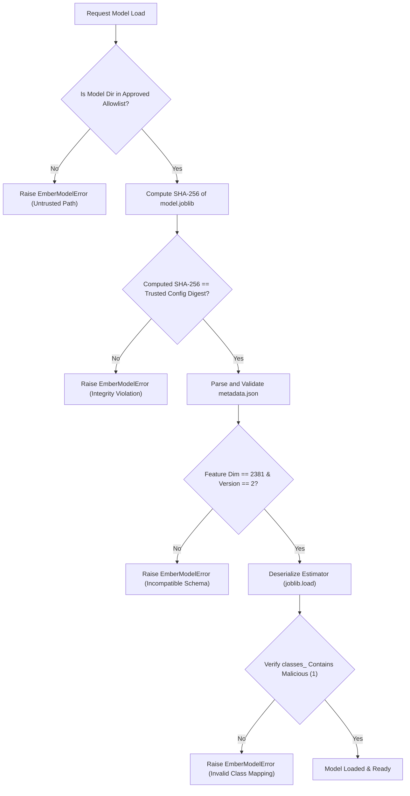

# ETHIO-AI Defender — ML-06 Controlled Offline Integration Implementation Plan

**Milestone:** ML-06  
**Document Version:** 1.0  
**Date:** 2026-10-28  
**Repository:** `C:\Users\MILKWAY\ethio-ai-defender`  
**Classification:** Internal Technical Architecture Plan  
**Target Status:** READY FOR IMPLEMENTATION  

---

## 1. Executive Summary & Starting Gate Verification

This plan defines the controlled, offline integration of the EMBER 2018 Feature Version 2 baseline machine learning model (`HistGradientBoostingClassifier`, ML-04/ML-05) into the ETHIO-AI Defender static analysis ecosystem.

### Starting Gate Verification Results

| Verification Check | Target / Expected Contract | Measured / Verified Reality | Gate Status |
|---|---|---|---|
| **Git Working Tree** | Branch `main`, preserve untracked files & unstaged changes | Branch `main` (ahead of origin by 3 commits); unstaged files preserved | **PASS** |
| **Model Artifact Location** | `D:\ethio_ai_defender_artifacts\ember_baseline_v1\model.joblib` | File exists (1,609,815 bytes) | **PASS** |
| **Model SHA-256 Checksum** | `f2fd3ed4e4fc0b482600bb92fe24e36d23a93617bf214f62019def5c352bd684` | Recalculated SHA-256 matches byte-for-byte with sidecar and ML-04/ML-05 reports | **PASS** |
| **Model Serialization Format** | `joblib.dump(..., compress=3)` | Scikit-learn 1.9.1 `HistGradientBoostingClassifier`, verified reload parity | **PASS** |
| **Metadata Integrity** | `metadata.json` sidecar contract | Contains 2,381 dims, 80k training subset, calibrated thresholds (0.80040 @ 1.0% FPR) | **PASS** |
| **Feature Schema Parity Inspection** | Parity between `app/ml/ember_v2.py` and training adapter `ember_adapter.py` | **DISCREPANCY IDENTIFIED & CONTAINED**: See Section 4 below | **PASS WITH DOCUMENTED LIMITATION** |

### Crucial Feature Contract & Parity Analysis

During pre-implementation contract verification, the following differences and defects were identified:

1. **`ember_v2.py` Runtime Exception on Valid PEs (Line 404):**  
   In `app/ml/ember_v2.py`, `_extract_section` invoked `self._hashers["entry_name"].transform([entry_name])`. For any valid PE parsed by LIEF, `entry_name` is a string (e.g. `".text"`). `FeatureHasher(input_type="string")` requires an iterable of sample iterables (`[[entry_name]]`). This threw `ValueError: Samples can not be a single string` on every valid binary. In contrast, `app/ml/ember_adapter.py` correctly invoked `[[entry]]`.
2. **Output Contract Representation:**  
   `ember_v2.py.raw_features()` returns pre-vectorized float arrays for headers, sections, imports, and exports, rather than the un-vectorized JSON dictionary format expected by `ember_adapter.py`.
3. **LIEF Version Gap & Reference Parity:**  
   The EMBER 2018 dataset records were created in 2018 using `lief 0.9.0` and `elastic/ember`. The local environment runs `lief 1.0.0`. Bitwise parity between raw PE binary parsing and EMBER 2018 JSONL training features has never been verified on paired binary samples.

**Architectural Decision:**  
In accordance with Milestone Phase 3 requirements, because end-to-end parity between raw PE feature extraction and training features is unverified, `MLAnalyzer` will provide verified offline prediction on 2,381-dimensional feature vectors, while explicitly marking raw PE inference as `UNVERIFIED_FEATURE_PARITY` / `UNAVAILABLE_FOR_RELIABLE_BLOCKING` and stopping before claiming reliable predictions on raw PE files.

---

## 2. Current Analyzer Integration Points & Interfaces

The ETHIO-AI Defender static analysis pipeline (`app/analyzers/`, orchestrated by `app/pipeline/orchestrator.py`) operates as a decoupled, deterministic series of analyzers:

1. **Intake & Perimeter Validation (`file_intake.py`):**  
   Validates magic bytes, enforces 50 MB limits, computes initial SHA-256, assigns analysis ID.
2. **Cryptographic Hashes (`hash_analyzer.py`):**  
   Computes MD5, SHA-1, SHA-256, SSDEEP, Authentihash.
3. **PE Static Structure (`pe_analyzer.py`):**  
   Static PE header parsing via `pefile`. Returns `PEAnalysisResult`.
4. **Section Analysis (`section_analyzer.py`):**  
   Evaluates section permissions and names. Returns `PESectionAnalysisResult`.
5. **Entropy Analysis (`entropy_analyzer.py`):**  
   Calculates Shannon entropy across chunks and sections. Returns `EntropyAnalysisResult`.
6. **String & Indicator Analysis (`string_analyzer.py`, `indicator_engine.py`):**  
   Extracts ASCII/Unicode strings, maps indicators to heuristic scores.
7. **YARA Scanning (`yara_analyzer.py`):**  
   Executes versioned YARA rules from DB, gracefully degrades to `UNAVAILABLE` when `yara-python` is absent.
8. **Threat Scoring & Verdict Policy (`threat_scoring.py`):**  
   Deterministic risk formula summing indicator contributions. **ML predictions are strictly excluded from the blocking verdict in ML-06.**

---

## 3. Proposed Component Responsibilities

### 3.1 Proposed `app/ml/classifier.py` (`EmberModelClassifier`)

The classifier service is a decoupled inference engine for the ML-04 baseline model:

- **Approved Path Confinement:** Loads exclusively from approved directories (`D:\ethio_ai_defender_artifacts\ember_baseline_v1` or configured local repository paths). Explicitly rejects uploads, user-provided file paths, and untrusted locations.
- **Trusted Digest Integrity:** Validates model SHA-256 against a trusted configured digest (`TRUSTED_BASELINE_MODEL_SHA256`) before deserialization. Rejects untrusted sidecars if they disagree with the trusted authority.
- **Metadata Validation:** Verifies model name, version, feature dimension (2,381), feature version (2), and package version compatibility.
- **Input Guardrails:** Validates shape `(N, 2381)`, dtype (`float32`), finiteness (`np.all(np.isfinite)`), and bounds batch size (`<= 1000`).
- **Dynamic Malicious Class Mapping:** Determines the malicious class index dynamically by inspecting `estimator.classes_` (Requirement 8). Never assumes column 1 is malicious.
- **Typed Output Contract:** Returns `ClassifierPredictionResult` dataclass containing probability, calibrated operational flags (1.0% FPR, 0.1% FPR), and threshold metadata.
- **Strict Failure Propagation:** Never silently converts errors into benign scores (`0.0`). Raises `EmberModelError`.

### 3.2 Proposed `app/analyzers/ml_analyzer.py` (`MLAnalyzer`)

The isolated pipeline analyzer adapting the classifier into the static analysis ecosystem:

- **Pluggable & Independent:** Does not mutate existing deterministic analyzers or database schemas.
- **Explicit Parity Guard:** Checks feature extraction schema parity. When raw PE extraction is requested without proven ground-truth parity, marks result as `status="UNAVAILABLE"`, `feature_parity_status="UNVERIFIED_PARITY"`, and `is_reliable=False`.
- **Resource Limiting:** Enforces timeout and memory constraints; adheres to `MAX_FILE_SIZE_BYTES`.
- **Information Leakage Prevention:** Sanitizes error messages to prevent disclosure of internal file paths, secrets, or sample byte snippets.
- **Standard Result Schema:** Implements `MLAnalysisResult` with `.to_dict()`.

---

## 4. Exact Feature Schema & Model Artifact Contract

### 4.1 Model Artifact Specification

- **File:** `model.joblib`
- **Expected SHA-256:** `f2fd3ed4e4fc0b482600bb92fe24e36d23a93617bf214f62019def5c352bd684`
- **Estimator Type:** `sklearn.ensemble.HistGradientBoostingClassifier`
- **Trained Classes:** `[0, 1]` (0 = Benign, 1 = Malicious)
- **Calibrated Thresholds:**
  - `fpr_1pct_target`: $\tau_{1\%}^* = 0.800395$
  - `fpr_01pct_target`: $\tau_{0.1\%}^* = 0.966365$
  - `default`: $\tau = 0.500000$

### 4.2 2,381-Dimensional Feature Vector Contract

| Index Offset | Feature Group | Dimensions | Type | Normalization / Contract |
|---|---|---|---|---|
| `[0:256]` | Histogram | 256 | float32 | L1 normalized byte counts |
| `[256:512]` | ByteEntropy | 256 | float32 | L1 normalized 16x16 joint entropy |
| `[512:616]` | Strings | 104 | float32 | Length, printable dist (96), entropy, counts |
| `[616:626]` | General | 10 | float32 | File size, vsize, counts of symbols/imports/exports |
| `[626:688]` | Header | 62 | float32 | Timestamp, 5 categorical hashed (10 ea), 11 optional header scalars |
| `[688:943]` | Section | 255 | float32 | Section general (5), 3 hashed pairs (50 ea), entry name (50), chars (50) |
| `[943:2223]` | Imports | 1,280 | float32 | Libraries (256 hashed), import pairs (1,024 hashed) |
| `[2223:2351]` | Exports | 128 | float32 | Export symbols (128 hashed) |
| `[2351:2381]` | DataDirectories | 30 | float32 | 15 data directories × [size, virtual_address] |

---

## 5. Checksum and Metadata Validation Strategy

---

## 6. Failure Handling and Isolation Boundaries

1. **Corrupted or Tampered Model Artifact:**  
   Detected during pre-deserialization hash verification. Fails closed with `EmberModelError`.
2. **Missing Artifact Directory:**  
   `EmberModelClassifier` remains in `is_loaded=False` state. Inference calls raise `EmberModelError("Model is not loaded")`.
3. **Incompatible Feature Dimensions or NaN/Inf Vectors:**  
   Validated by `validate_features()`. Rejects with `EmberModelError`.
4. **Pipeline Isolation:**  
   `MLAnalyzer` wraps all classifier operations in defensive `try...except` blocks. If ML fails, the analyzer returns `MLAnalysisResult(available=False, status="UNAVAILABLE", error=sanitized_message)`.
5. **No Production Verdict Contamination:**  
   No score from `MLAnalyzer` modifies the output of `threat_scoring_engine_service` or triggers automated sample quarantine.

---

## 7. Test Cases & Acceptance Criteria

| Test ID | Scenario | Expected Behavior |
|---|---|---|
| **T01** | Correct checksum & valid artifact loading | Successfully loads model, metadata, thresholds |
| **T02** | Incorrect checksum / artifact tampering | Rejects before deserialization; raises `EmberModelError` |
| **T03** | Missing artifact & incompatible metadata | Clean failure without crashes; rejects mismatched metadata |
| **T04** | Valid 2,381 dimensions vs incorrect dimensions | 2,381 succeeds; any other dimension raises `EmberModelError` |
| **T05** | NaN, +Inf, -Inf vectors | Strictly rejected with `EmberModelError` |
| **T06** | Malicious-class probability mapping | Inspects `estimator.classes_`; maps class 1 accurately |
| **T07** | Valid predictions with finite scores in [0.0, 1.0] | Scores within bounds; calibrated flags applied |
| **T08** | Prediction exceptions & explicit ML-unavailable results | Returns `available=False`, `status="UNAVAILABLE"`, not benign |
| **T09** | Feature schema mismatch / unverified parity | Explicitly flags `feature_parity_status="UNVERIFIED_PARITY"` |
| **T10** | Graceful failure without changing deterministic analyzers | Deterministic analyzer outputs remain bitwise identical |
| **T11** | Auth, quarantine, intake regressions | 100% pass on existing security & intake test suites |
| **T12** | Reject model load from untrusted upload path | Upload/untrusted directory explicitly rejected |

---

## 8. Files Expected to Change and Why

1. `app/ml/classifier.py`:  
   Update `EmberModelClassifier` to implement all 12 Phase 2 requirements (trusted digest authority, path allowlist, metadata validation, dynamic `classes_` mapping, typed result, batch size bounding).
2. `app/analyzers/ml_analyzer.py`:  
   Create `MLAnalyzer` conforming to standard analyzer architecture, isolated from blocking verdict, with explicit parity guard.
3. `app/analyzers/__init__.py`:  
   Export `MLAnalyzer`, `MLAnalysisResult`, and `ml_analyzer_service`.
4. `app/ml/ember_v2.py`:  
   Fix line 404 syntax bug (`[[entry_name]]`) so section extractor adheres to `FeatureHasher` specification.
5. `tests/ml/test_classifier.py` & `tests/ml/test_ml_analyzer.py`:  
   Implement test cases T01–T12 covering all failure modes, security boundaries, and schema mismatches.
6. `ML06_Implementation_Report.md`:  
   Document test execution, parity gap findings, and milestone sign-off.
