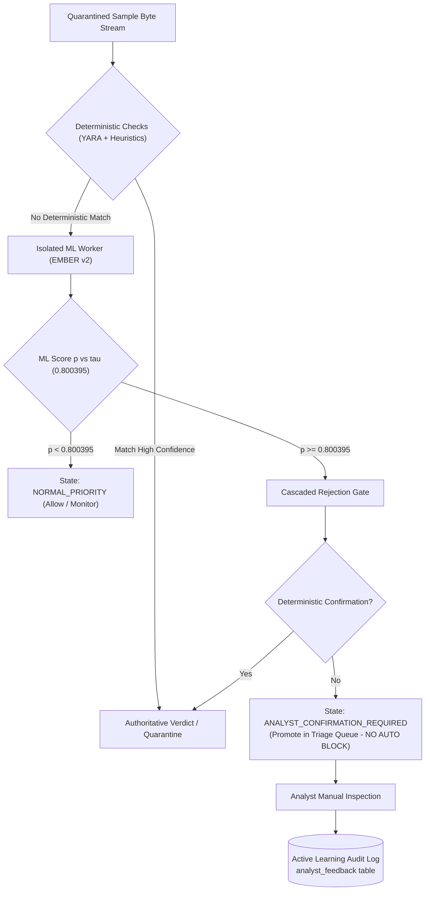
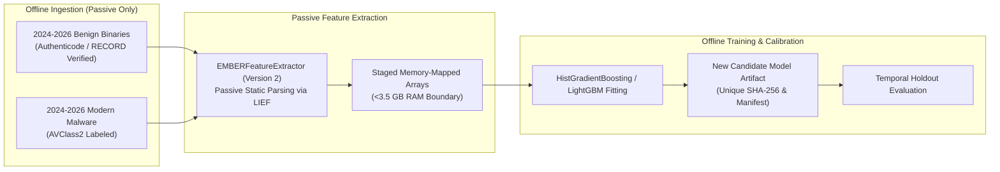
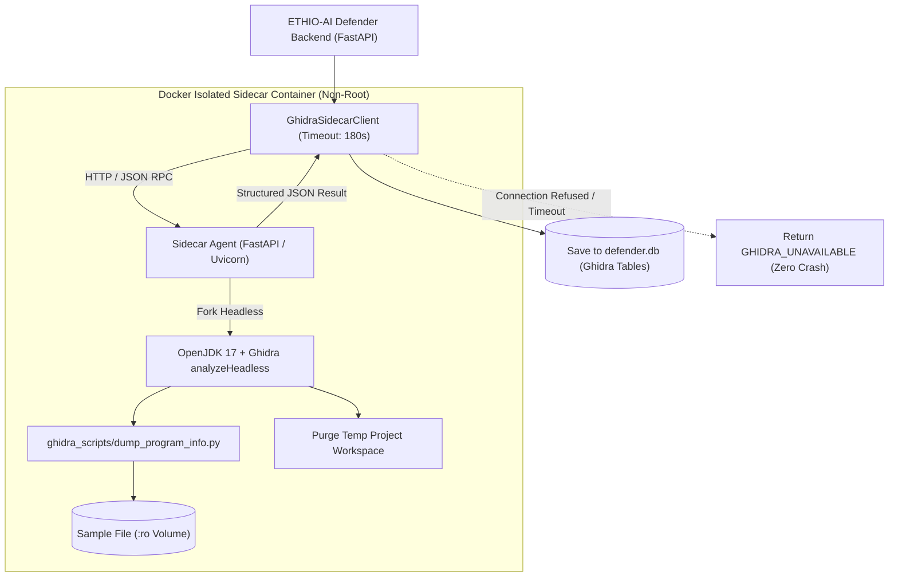
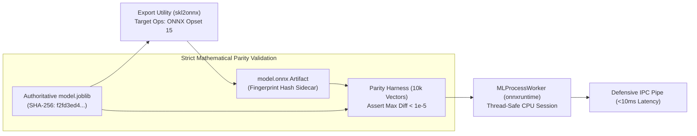

# ETHIO-AI DEFENDER — RELEASE-03 CORRECTIVE ROADMAP
**Document ID:** ROADMAP-RELEASE-03  
**Date:** October 28, 2026  
**Status:** PROPOSED CORRECTIVE SPECIFICATION (PLANNING PHASE)  
**Author:** Senior Application-Security, ML Evaluation, and Release Engineering Team  
**Governing Audit Target:** [RELEASE02_Independent_Verification_Report.md](file:///C:/Users/MILKWAY/ethio-ai-defender/RELEASE02_Independent_Verification_Report.md)  
**Deployment State:** Controlled Analyst-Assisted Advisory Triage (`ML_ENABLED=false`, Parity Gate CLOSED, Non-Authoritative)

---

## 1. EXECUTIVE SUMMARY & POST-RELEASE-02 POSTURE

The independent release verification gate conducted in [RELEASE02_Independent_Verification_Report.md](file:///C:/Users/MILKWAY/ethio-ai-defender/RELEASE02_Independent_Verification_Report.md) confirmed that ETHIO-AI Defender is structurally sound, regression-tested (712/712 tests passing), and secure against live PE execution. However, release authorization was granted **strictly with limitations**: autonomous host-level blocking or quarantine is strictly prohibited due to base-rate precision collapse and temporal drift.

This document establishes the **RELEASE-03 Corrective Roadmap**. Rather than repeating the completed release audit, this roadmap defines the technical specifications, architectural boundaries, risk mitigations, acceptance criteria, and regression test suites for the four corrective milestones identified in RELEASE-02:
1. **ML-13**: Active Learning & Cascaded Rejection Gate
2. **ML-14**: Modern Corpus Retraining Pipeline
3. **OPS-02**: Containerized Ghidra Sidecar Service
4. **PERF-01**: Inference Engine Optimization (ONNX Runtime Export)

```
====================================================================================================
                                SYSTEM POSTURE & INVARIANT FREEZE
====================================================================================================
Operational DB Path        : storage/defender.db (SHA-256: 02D51F7A39E07B1C9716BB5420BC72D81CF6AB103580BA06AEF3FE442D7AEC24)
Authoritative Model Hash   : F2FD3ED4E4FC0B482600BB92FE24E36D23A93617BF214F62019DEF5C352BD684 (D:\ethio_ai_defender_artifacts\...)
Secondary Model Hash       : BAF625E1787C6E3B6E2648CAEA2020435A95F077C53A1D5B52D1087EFB25E59B (storage\models\...)
Runtime Inference Flag     : ML_ENABLED=false (Explicit opt-in required for shadow execution)
Parity Gate State          : CLOSED (is_reliable = False, Hardcoded in app/ml/analyzer.py)
Authority Level            : Tier 0 Non-Authoritative Telemetry (0% autonomous intervention authority)
Live Binary Detonation     : ZERO (Strict passive static analysis via pefile and lief)
Working Tree Preserved     : Unmodified frontend changes and untracked validation reports strictly preserved
====================================================================================================
```

---

## 2. RECONCILIATION OF THE 3.73% PRECISION & 22,350 FALSE-BLOCK FINDING

In RELEASE-02 Section 6, the independent audit reported that at an enterprise operating prevalence of 0.1% (1000:1 benign-to-malware ratio), operating at threshold $\tau_{1\%}^* = 0.800395$ produces a **projected precision of 3.73%** and results in **22,350 false blocks**. This section provides the rigorous mathematical reconciliation, explicit formulas, denominators, and foundational assumptions behind these figures.

### 2.1 Empirical Parameters from 200,000 EMBER Test Holdout

From the verified ML-09 streaming evaluation across the 200,000-record EMBER test partition ([`storage/ember2018/test_features.jsonl`](file:///C:/Users/MILKWAY/ethio-ai-defender/storage/ember2018/test_features.jsonl)):
- **Total Test Records ($N_{test}$):** $200,000$
- **Benign Test Records ($N_{test\_benign}$):** $100,000$ (Label `0`)
- **Malicious Test Records ($N_{test\_malicious}$):** $100,000$ (Label `1`)
- **Threshold Under Evaluation:** $\tau_{1\%}^* = 0.800395$ (Calibrated on validation split $N=52,073$ to achieve $1.0\%$ FPR)
- **Empirical Test True Positives ($TP_{test}$):** $86,527$
  $$\text{TPR} = \frac{TP_{test}}{N_{test\_malicious}} = \frac{86,527}{100,000} = 86.527\% \quad (\text{Wilson 95\% CI: } [86.315\%, 86.737\%])$$
- **Empirical Test False Positives ($FP_{test}$):** $2,235$
  $$\text{FPR} = \frac{FP_{test}}{N_{test\_benign}} = \frac{2,235}{100,000} = 2.235\% \quad (\text{Wilson 95\% CI: } [2.145\%, 2.328\%])$$

> [!NOTE]
> On the balanced 1:1 test partition, measured precision is $\frac{86,527}{86,527 + 2,235} = \frac{86,527}{88,762} = 97.48\%$. However, real-world enterprise environments do not present an artificial 1:1 ratio.

### 2.2 Enterprise Fleet Modeling Assumptions

To evaluate the operational impact on an enterprise fleet processing executables across workstations and network shares:
1. **Benign-to-Malware Imbalance Ratio:** $1,000 : 1$ (For every $1$ malware sample encountered, $1,000$ benign executables, libraries, installers, or runtime updates are processed).
2. **Prevalence Denominator Population:** $N_{enterprise} = 1,001,000$ submissions.
   - Benign Binaries Denominator ($N_B$): $1,000,000$
   - Malicious Binaries Denominator ($N_M$): $1,000$
   - Base Rate of Malware: $P(M) = \frac{1,000}{1,001,000} \approx 0.000999001 \approx 0.1\%$
   - Base Rate of Benign: $P(B) = \frac{1,000,000}{1,001,000} \approx 0.999000999 \approx 99.9\%$

### 2.3 Mathematical Derivation & Exact Denominators

#### Step 1: Discrete Contingency Table Projection

$$\text{True Positives } (TP) = N_M \times \text{TPR} = 1,000 \times 0.86527 = 865.27 \approx 865 \text{ detected threats}$$

$$\text{False Positives } (FP) = N_B \times \text{FPR} = 1,000,000 \times 0.02235 = 22,350 \text{ falsely blocked benign binaries}$$

$$\text{Total Interventions / Alerts} = TP + FP = 865 + 22,350 = 23,215$$

#### Step 2: Positive Predictive Value (Precision) Calculation

$$\text{Projected Precision} = \frac{TP}{TP + FP} = \frac{865}{23,215} = \frac{865}{865 + 22,350} = \frac{865}{23,215} \approx 0.0372604 \implies \mathbf{3.73\%}$$

#### Step 3: False Alarm Rate Calculation

$$\text{False Alarm Rate (False Discovery Rate)} = \frac{FP}{TP + FP} = \frac{22,350}{23,215} \approx 0.9627396 \implies \mathbf{96.27\%}$$

#### Step 4: Verification via Continuous Bayes' Theorem

$$\text{Precision} = P(M \mid \text{Alert}) = \frac{P(\text{Alert} \mid M) \cdot P(M)}{P(\text{Alert} \mid M) \cdot P(M) + P(\text{Alert} \mid B) \cdot P(B)}$$

$$\text{Precision} = \frac{\text{TPR} \cdot P(M)}{\text{TPR} \cdot P(M) + \text{FPR} \cdot P(B)}$$

Using $P(M) = 0.001$ and $P(B) = 0.999$:
$$\text{Precision} = \frac{0.86527 \times 0.001}{(0.86527 \times 0.001) + (0.02235 \times 0.999)} = \frac{0.00086527}{0.00086527 + 0.02232765} = \frac{0.00086527}{0.02319292} \approx 0.0373075 \implies \mathbf{3.73\%}$$

### 2.4 Operational Denial-of-Service Impact

The physical consequence of this mathematical reality is severe:
- If autonomous host blocking or quarantine were enabled at $\tau = 0.800395$, the system would successfully quarantine **865 real threats** but would simultaneously break and isolate **22,350 legitimate workstation binaries, system DLLs, developer compilers, and line-of-business applications**.
- **96.27 out of every 100 blocks would be an erroneous denial-of-service against the enterprise**.
- This proves why `ML_ENABLED=false` and a closed Parity Gate (`is_reliable=False`) are non-negotiable safety boundaries until a secondary cascaded rejection gate (ML-13) is established.

---

## 3. MILESTONE ML-13: ACTIVE LEARNING & CASCADED REJECTION GATE

### 3.1 Problem Statement
Operating ML predictions autonomously at enterprise scale collapses precision to 3.73% (LIM-01). The system currently lacks an architectural separation between **statistical risk prioritization** and **authoritative automated intervention**. Without a secondary verification layer, ML inference cannot safely participate in operational response.

### 3.2 Evidence & Verification Status
- **Empirical Base-Rate Collapse:** Formally validated in RELEASE-02 Section 6 (3.73% precision, 22,350 false positives per 1,000,000 files).
- **Advisory Dashboard Status:** Verified in [docs/ML12B_Advisory_Dashboard_Integration_Report.md](file:///C:/Users/MILKWAY/ethio-ai-defender/docs/ML12B_Advisory_Dashboard_Integration_Report.md) that ML scores are exposed strictly as non-authoritative prioritization badges (`review_priority="ELEVATED"`).
- **Operational Quarantine Mechanism:** Verified in [app/analyzers/quarantine.py](file:///C:/Users/MILKWAY/ethio-ai-defender/app/analyzers/quarantine.py) and pipeline orchestrator; automated quarantine is currently gated strictly behind deterministic indicators.
- **Active Learning Feedback Loop:** **NOT VERIFIED (Not implemented in repository; no database feedback tables or active learning endpoints exist)**.

### 3.3 Scope & Architecture
1. **Cascaded Multi-Stage Rejection Architecture:**
   - **Stage 1 (Passive Heuristic & Signature Filtering):** Fast deterministic scan via YARA and static PE heuristics. If a deterministic malicious match occurs, authoritative action may proceed.
   - **Stage 2 (ML Statistical Risk Scoring):** For files passing Stage 1 without deterministic matches, ML inference provides continuous risk score $p \in [0, 1]$.
   - **Stage 3 (Cascaded Rejection & Escalation Gate):**
     - If $p < \tau_{1\%}^*$ (0.800395): Mark as `NORMAL_PRIORITY`, allow execution / standard handling.
     - If $p \ge \tau_{1\%}^*$ (0.800395) AND no deterministic signature matches: Transition sample state to `ANALYST_CONFIRMATION_REQUIRED`. Autonomous quarantine is **prohibited**. The sample is promoted to the top of the analyst triage queue.
2. **Active Learning Feedback Pipeline:**
   - Implement an append-only feedback table (`analyst_feedback`) recording: `analysis_id`, `sample_sha256`, `model_id`, `predicted_prob`, `analyst_verdict` (`CONFIRMED_MALWARE`, `FALSE_POSITIVE`, `BENIGN_UTILITY`), `analyst_id`, and `timestamp`.
   - Export curated feedback sets into offline staging partitions for future model calibration.



### 3.4 Files Affected
- [`app/pipeline/orchestrator.py`](file:///C:/Users/MILKWAY/ethio-ai-defender/app/pipeline/orchestrator.py): Integrate cascaded gate logic preventing automated quarantine on ML score alone.
- [`app/analyzers/threat_scoring.py`](file:///C:/Users/MILKWAY/ethio-ai-defender/app/analyzers/threat_scoring.py): Separate heuristic threat score from ML advisory score.
- [`app/db/models.py`](file:///C:/Users/MILKWAY/ethio-ai-defender/app/db/models.py): Add `AnalystFeedback` model and `rejection_gate_state` enum.
- [`app/db/schemas.py`](file:///C:/Users/MILKWAY/ethio-ai-defender/app/db/schemas.py): Expose review action requests and feedback submission schemas.
- [`app/api/analyses.py`](file:///C:/Users/MILKWAY/ethio-ai-defender/app/api/analyses.py): Add `POST /api/analyses/{id}/feedback` endpoint with RBAC (`ANALYST` or `ADMIN`).
- `alembic/versions/`: Migration creating `analyst_feedback` table.
- [`frontend/static/js/app.js`](file:///C:/Users/MILKWAY/ethio-ai-defender/frontend/static/js/app.js): Add interactive analyst confirmation buttons and review status filters.

### 3.5 Concrete Acceptance Criteria
- [ ] **Zero Autonomous ML Blocking:** Pipeline logic mathematically asserts that no sample with `yara_matches == []` and `heuristic_score < 70` can transition to `QUARANTINED` or `BLOCKED` based purely on `ml_score >= 0.800395`.
- [ ] **State Machine Enforcement:** High ML samples without signatures enter state `ANALYST_CONFIRMATION_REQUIRED` and appear in prioritized triage views.
- [ ] **RBAC Protected Feedback:** Only authenticated users with `role in ["ANALYST", "ADMIN"]` can submit feedback verdicts via `POST /api/analyses/{id}/feedback`.
- [ ] **Database Invariant Preserved:** Migration applies cleanly via Alembic without touching or mutating historical analysis records in operational `defender.db`.
- [ ] **Audit Trail:** Every feedback submission generates an append-only `AuditLogger` event.

### 3.6 Regression Test Plan
- Unit test: Submit sample with `ml_score = 0.99` but 0 YARA matches; verify sample status is `ANALYST_CONFIRMATION_REQUIRED` and file is not quarantined.
- Unit test: Submit sample with `ml_score = 0.99` AND a high-confidence YARA match; verify sample status transitions to `MALICIOUS` via deterministic authority.
- RBAC test: Verify `VIEWER` role receives HTTP 403 Forbidden when attempting to submit active learning feedback.
- Full regression: All 712 baseline tests continue to pass with 0 failures.

### 3.7 Operational & Security Risks
- **Analyst Queue Fatigue:** If enterprise sample volume is high, the number of files requiring manual triage could overwhelm SOC analysts if threshold $\tau$ is set too low.
- **Feedback Poisoning:** A compromised analyst account could intentionally submit false feedback to degrade future retraining sets. Mitigated by RBAC and audit logging.

---

## 4. MILESTONE ML-14: MODERN CORPUS RETRAINING PIPELINE

### 4.1 Problem Statement
The authoritative model was trained on historical data spanning 2006 to June 2018 (LIM-02). Forward-looking testing demonstrated a 2.24x surge in False Positive Rate due to temporal drift. Modern threat actors employ modern packers, obfuscators, and API hashing techniques (2024-2026) that are poorly represented in the 2018 EMBER feature space.

### 4.2 Evidence & Verification Status
- **Temporal Drift Documented:** Verified in RELEASE-02 Section 5.3 (FPR surged from 1.0% to 2.235% across a 5-month temporal gap).
- **Historical Partition Lineage:** Verified in [docs/ML10_Independent_Evaluation_and_Leakage_Audit.md](file:///C:/Users/MILKWAY/ethio-ai-defender/docs/ML10_Independent_Evaluation_and_Leakage_Audit.md) (Train: 337,353 records pre-2018-06; Test: 200,000 records Nov-Dec 2018).
- **Local Benign Corpus Status:** Verified in [docs/ML12A_Local_Benign_Calibration_Report.md](file:///C:/Users/MILKWAY/ethio-ai-defender/docs/ML12A_Local_Benign_Calibration_Report.md) that local developer binaries ($N=251$) produce 0% FPR at $\tau_{1\%}^*$, but Ethiopian organizational software is **`BLOCKED ON CORPUS (Domain-Specific Gap)`**.
- **Modern 2024-2026 Training Dataset:** **NOT VERIFIED (No 2024-2026 dataset exists in repository or artifact storage; `storage/` contains only EMBER 2018 v2)**.

### 4.3 Scope & Architecture
1. **Offline Ingestion & Curation Architecture:**
   - Ingestion is conducted strictly in an isolated, offline environment.
   - Separate corpora:
     - Modern Enterprise Benign Corpus (2024-2026 legitimate Windows utilities, drivers, and Ethiopian institutional software).
     - Modern Threat Corpus (2024-2026 malware samples classified by AVClass2).
2. **Streaming Feature Extraction Pipeline:**
   - Use the verified `EMBERFeatureExtractor` ([`app/ml/ember_v2.py`](file:///C:/Users/MILKWAY/ethio-ai-defender/app/ml/ember_v2.py)) operating in pure passive static mode via `lief` and `pefile`.
   - Stream extracted vectors directly to staged memory-mapped files (`X_modern.mmap`, `y_modern.mmap`) to enforce the <3.5 GB physical RAM ceiling.
3. **Model Versioning & Sidecar Cryptographic Provenance:**
   - New candidate model trained offline: `ember-v2-modern-hgb-2026`.
   - Never replace the authoritative baseline (`f2fd3ed4...`). Candidate models are written to distinct artifact directories with SHA-256 sidecars and full provenance manifests.



### 4.4 Files Affected
- `scripts/ingest_modern_corpus.py` (New offline ingestion script)
- `scripts/extract_features_streaming.py` (Memory-safe streaming extractor)
- `scripts/train_modern_baseline.py` (Offline training script with deterministic random seed)
- [`app/ml/classifier.py`](file:///C:/Users/MILKWAY/ethio-ai-defender/app/ml/classifier.py): Support multi-model registry and cryptographic validation for candidate artifacts.
- `docs/data/MODERN_CORPUS_PROVENANCE.md` (Detailed provenance and licensing documentation).

### 4.5 Concrete Acceptance Criteria
- [ ] **Authoritative Artifact Preserved:** The original model (`D:\ethio_ai_defender_artifacts\ember_baseline_v1\model.joblib`, SHA-256: `f2fd3ed4...`) and in-repo model (`storage/models/...`, SHA-256: `baf625e1...`) remain bit-identical and untouched.
- [ ] **Zero Binary Execution:** Modern feature extraction operates purely on passive byte streams. Zero process execution or dynamic emulation is permitted.
- [ ] **Cryptographic Lineage Manifest:** The candidate model artifact includes a `metadata.json` documenting exact training sample hashes, date boundaries, feature schema version (2381-dim), and training hyperparameter log.
- [ ] **Temporal Validation Gate:** The modern model must achieve $\text{ROC-AUC} \ge 0.98$ and empirical $\text{FPR} \le 1.0\%$ on a held-out temporal partition prior to consideration for runtime shadow deployment.
- [ ] **RAM Ceiling Respected:** Peak memory usage during feature extraction and training must remain strictly below 3.5 GB.

### 4.6 Regression Test Plan
- Unit tests validating that the modern feature extractor matches EMBER v2 2381-dimension output on synthetic test fixtures.
- Model integrity tests verifying that `TRUSTED_BASELINE_MODEL_SHA256` in `classifier.py` continues to block unauthorized model substitution.
- Dataset leakage audit script confirming 0 hash overlap between new training and evaluation splits.

### 4.7 Operational & Security Risks
- **Data Poisoning / Label Inversion:** Mislabeling modern benign software as malware would permanently degrade calibration. Requires strict Authenticode digital signature verification.
- **Corpus Availability Bottleneck:** Sourcing legitimate Ethiopian enterprise software without violating host boundary constraints (Constraint 10) remains an environmental dependency.
- **Parser Exploitation:** Malformed modern PE binaries designed to exploit `pefile` or `lief` buffer overflows could crash the extractor. Mitigated by isolated worker boundaries and timeouts.

---

## 5. MILESTONE OPS-02: CONTAINERIZED GHIDRA SIDECAR SERVICE

### 5.1 Problem Statement
In the local host environment, Ghidra headless is uninstalled, `GHIDRA_HOME` is unset, and the installed Java runtime is obsolete (Java 1.8 vs required JDK 17+/21+) (LIM-03). While the pipeline degrades gracefully (`GHIDRA_UNAVAILABLE`), deep static decompilation and function call graph extraction cannot execute locally.

### 5.2 Evidence & Verification Status
- **Host Audit Verified:** Confirmed in [GHIDRA01_Integration_Report.md](file:///C:/Users/MILKWAY/ethio-ai-defender/GHIDRA01_Integration_Report.md) (Java 1.8.0_111 detected, missing `analyzeHeadless.bat`, pipeline status `UNAVAILABLE`).
- **Graceful Degradation Verified:** Verified in RELEASE-02 Section 8.5 and [tests/test_ghidra_analyzer.py](file:///C:/Users/MILKWAY/ethio-ai-defender/tests/test_ghidra_analyzer.py) (10 tests passing, returns safe fallback payload).
- **Existing Integration Scripts:** Verified on disk: [`ghidra_scripts/dump_program_info.py`](file:///C:/Users/MILKWAY/ethio-ai-defender/ghidra_scripts/dump_program_info.py) and [`app/analyzers/ghidra_analyzer.py`](file:///C:/Users/MILKWAY/ethio-ai-defender/app/analyzers/ghidra_analyzer.py).
- **Dockerized Ghidra Container:** **NOT VERIFIED (No Dockerfile, compose file, or sidecar service currently exists in repository)**.

### 5.3 Scope & Architecture
1. **Containerized Ghidra Headless Sidecar:**
   - Package official Ghidra release (11.x) with Eclipse Temurin OpenJDK 17 into an isolated, hardened Linux-based Docker container.
   - Run a lightweight Python FastAPI agent inside the sidecar exposing an internal, authenticated RPC endpoint: `POST /analyze`.
2. **Defensive Isolation & Read-Only Mounting:**
   - The main backend interacts with the sidecar over a local Unix domain socket or internal loopback network (`127.0.0.1:8089`).
   - Quarantined binaries are shared via temporary read-only volume mounts (`:ro`). Ghidra runs under a non-root user (`ghidra:ghidra`) with dropped capabilities (`cap_drop: ALL`).
3. **Graceful Fallback Preservation:**
   - If Docker is not installed, the daemon is stopped, or the sidecar container is unreachable, the backend client immediately returns `status="GHIDRA_UNAVAILABLE"` without blocking or failing the analysis pipeline.



### 5.4 Files Affected
- `docker/ghidra-sidecar/Dockerfile` (New container definition with OpenJDK 17 & Ghidra 11.x)
- `docker/ghidra-sidecar/sidecar_server.py` (Lightweight internal RPC service)
- `docker-compose.yml` (Orchestration config defining sidecar and volume mounts)
- [`app/analyzers/ghidra_analyzer.py`](file:///C:/Users/MILKWAY/ethio-ai-defender/app/analyzers/ghidra_analyzer.py): Update analyzer to route requests to sidecar when configured.
- [`app/core/config.py`](file:///C:/Users/MILKWAY/ethio-ai-defender/app/core/config.py): Add `GHIDRA_SIDECAR_URL`, `GHIDRA_SIDECAR_ENABLED`.
- [`tests/test_ghidra_analyzer.py`](file:///C:/Users/MILKWAY/ethio-ai-defender/tests/test_ghidra_analyzer.py): Add sidecar connection and timeout tests.

### 5.5 Concrete Acceptance Criteria
- [ ] **Zero Host JDK Dependency:** Static Ghidra reverse engineering executes successfully on any platform supporting Docker without requiring Java or Ghidra installed on the host OS.
- [ ] **Hardened Non-Root Execution:** The sidecar container executes strictly as non-root user, drops Linux capabilities, and mounts samples read-only.
- [ ] **Deterministic Resource Limits:** Sidecar memory is capped at 4 GB, CPU capped at 2 cores, and process execution bounded by strict 180s timeout.
- [ ] **Graceful Degradation Preserved:** When sidecar is offline, all pipeline endpoints return HTTP 200 with `available: false, status: "UNAVAILABLE"`.
- [ ] **Output Schema Parity:** Extracted function signatures, entrypoints, and call graphs exactly match the existing database schema in [app/db/models.py](file:///C:/Users/MILKWAY/ethio-ai-defender/app/db/models.py).

### 5.6 Regression Test Plan
- Test sidecar unavailable: Stop container, submit analysis, verify response status is `UNAVAILABLE` and analysis pipeline completes without error.
- Mocked sidecar success: Mock sidecar endpoint returning valid function JSON; verify database persistence in isolated SQLite.
- Existing regression: Ensure all 10 existing `tests/test_ghidra_analyzer.py` test cases continue to pass.

### 5.7 Operational & Security Risks
- **Sidecar Denial of Service:** Very large or obfuscated PE binaries can trigger Ghidra analysis loops, causing 100% CPU utilization. Mitigated by Docker CPU limits and sidecar process timeouts.
- **Docker Socket Exposure:** Must not expose the host Docker socket (`docker.sock`) into the sidecar.

---

## 6. MILESTONE PERF-01: INFERENCE ENGINE OPTIMIZATION (ONNX RUNTIME)

### 6.1 Problem Statement
The current ML inference worker executes Python `joblib.load()` on scikit-learn's `HistGradientBoostingClassifier` within an isolated spawned worker process (LIM-04). While sub-40ms latency satisfies single-file CLI use, processing high-throughput submission queues (e.g. thousands of files) is CPU-bounded. Native LightGBM C++ binaries are difficult to bundle reliably across Windows environments without compiler toolchain dependencies.

### 6.2 Evidence & Verification Status
- **Worker Latency Verified:** Verified in RELEASE-01 & RELEASE-02 (IPC worker evaluates vector in ~38ms).
- **Windows LightGBM Friction Documented:** Documented in [ML02_COMPATIBILITY_REPORT.md](file:///C:/Users/MILKWAY/ethio-ai-defender/ML02_COMPATIBILITY_REPORT.md) and RELEASE-02 Section 4.1 (HistGradientBoosting chosen due to Windows LightGBM wheel/compilation barriers).
- **ONNX Export / Runtime Artifacts:** **NOT VERIFIED (No ONNX models, export scripts, or onnxruntime dependencies currently exist in codebase)**.

### 6.3 Scope & Architecture
1. **Model Export Pipeline via `skl2onnx`:**
   - Develop an offline export utility that converts the verified authoritative model (`model.joblib`) into an ONNX graph (`model.onnx`).
   - Validate mathematical equivalence on 10,000 reference feature vectors:
     $$\max |P_{\text{onnx}}(y=1 \mid X) - P_{\text{sklearn}}(y=1 \mid X)| < 10^{-5}$$
2. **ONNX Runtime Execution Provider Integration:**
   - Integrate `onnxruntime` (CPU execution provider) into the isolated `MLProcessWorker` ([`app/ml/process_worker.py`](file:///C:/Users/MILKWAY/ethio-ai-defender/app/ml/process_worker.py)).
   - Implement SHA-256 fingerprint validation on `model.onnx` prior to session initialization.
3. **Throughput & Memory Benchmarking:**
   - Benchmark batch inference throughput (vectors/second) and peak RSS memory across 50,000 EMBER vectors. Target: $\ge 2\times$ to $5\times$ speedup over scikit-learn.



### 6.4 Files Affected
- `scripts/export_onnx.py` (New export and mathematical validation script)
- [`app/ml/process_worker.py`](file:///C:/Users/MILKWAY/ethio-ai-defender/app/ml/process_worker.py): Update worker to load ONNX session when configured.
- [`app/ml/classifier.py`](file:///C:/Users/MILKWAY/ethio-ai-defender/app/ml/classifier.py): Add `TRUSTED_ONNX_MODEL_SHA256` constant and validation checks.
- `requirements.txt`: Add optional dependencies `onnxruntime>=1.17.0` and `skl2onnx>=1.16.0`.
- `tests/ml/test_onnx_inference.py` (New parity and performance verification tests).

### 6.5 Concrete Acceptance Criteria
- [ ] **Bitwise Parity Boundary:** Across all 10,000 reference evaluation vectors, probability divergence between ONNX Runtime and the authoritative `HistGradientBoostingClassifier` must not exceed $\epsilon = 10^{-5}$.
- [ ] **Demonstrated Speedup:** Single-vector inference latency must decrease by at least $2\times$ (targeting $<15\text{ms}$ per vector), with batch throughput increasing by at least $3\times$.
- [ ] **Tamper-Resistant Fingerprint:** The ONNX model artifact must verify its SHA-256 digest against a hardcoded constant before session creation.
- [ ] **Safe Fallback:** If `onnxruntime` is uninstalled or `model.onnx` is missing, the worker transparently falls back to `model.joblib` without crashing.
- [ ] **Process Isolation Intact:** All ONNX inference remains isolated inside the child worker process under `settings.ML_TIMEOUT_SECONDS`.

### 6.6 Regression Test Plan
- Parity test: Evaluate 1,000 synthetic EMBER vectors through both runtimes; assert `np.allclose(probs_onnx, probs_sklearn, atol=1e-5)`.
- Fallback test: Invalidate ONNX path, verify worker falls back to `joblib` and passes health check.
- Regression test: Run full 78 ML tests in `tests/ml/` to confirm zero regression.

### 6.7 Operational & Security Risks
- **Subtle Threshold Boundary Flips:** Minor floating-point discrepancies near the $\tau_{1\%}^* = 0.800395$ decision boundary could cause a sample with $p=0.800394$ in scikit-learn to become $p=0.800396$ in ONNX. Requires strict $\epsilon$-guard band.
- **Native Dependency Bloat:** C++ runtime DLLs bundled with `onnxruntime` must be compatible with Windows x64 without requiring operator MSVC redistributable installations.

---

## 7. EVIDENCE VERIFICATION & GROUNDING MATRIX

Treating all prior assertions as unverified until grounded on the local filesystem, the following table summarizes the evidentiary status across all proposed milestone domains:

| Milestone & Domain | Assertion / Requirement | Local Grounding / Supporting Evidence | Status |
| :--- | :--- | :--- | :--- |
| **Safety Invariant** | Operational DB pristine | `storage/defender.db` SHA-256 is `02D51F7A...` (Bit-identical) | **VERIFIED** |
| **Safety Invariant** | Authoritative model intact | `D:\ethio_ai_defender_artifacts\ember_baseline_v1\model.joblib` SHA-256 is `f2fd3ed4...` | **VERIFIED** |
| **Safety Invariant** | Secondary model intact | `storage\models\ember_baseline_v1\model.joblib` SHA-256 is `baf625e1...` | **VERIFIED** |
| **Safety Invariant** | ML Parity Gate closed | Hardcoded `is_reliable = False` in `app/ml/analyzer.py:275` | **VERIFIED** |
| **Safety Invariant** | Full regression pass | 712 tests pass in isolated memory DB (`pytest tests/ -q`) | **VERIFIED** |
| **ML-13** | Base-rate precision collapse | 3.73% precision / 22,350 false blocks derived from 200k EMBER test set | **VERIFIED** |
| **ML-13** | Advisory triage tags exist | `review_priority` (ELEVATED / NORMAL) implemented in Stage 11d | **VERIFIED** |
| **ML-13** | Active learning feedback table | No feedback table exists in `app/db/models.py` or database migrations | **NOT VERIFIED (Missing)** |
| **ML-14** | Historical temporal drift | 2.24x FPR increase documented between validation and temporal test set | **VERIFIED** |
| **ML-14** | Local benign developer corpus | $N=251$ developer PE binaries evaluated with 0% FPR at $\tau_{1\%}^*$ | **VERIFIED** |
| **ML-14** | Local Ethiopian software corpus | No local Ethiopian enterprise software exists in workspace | **NOT VERIFIED (Missing)** |
| **ML-14** | Modern 2024-2026 PE dataset | No 2024-2026 corpus exists in `storage/` or staging artifacts | **NOT VERIFIED (Missing)** |
| **OPS-02** | Ghidra absence on host | Java 8 installed (requires JDK 17+); `GHIDRA_HOME` unset; fallback works | **VERIFIED** |
| **OPS-02** | Docker sidecar container | No Dockerfile or compose files present in repository | **NOT VERIFIED (Missing)** |
| **PERF-01** | Single-vector inference latency | Sub-40ms IPC inference latency verified via child worker | **VERIFIED** |
| **PERF-01** | ONNX Runtime implementation | No ONNX models, export tools, or runtime dependencies present | **NOT VERIFIED (Missing)** |

---

## 8. PRIORITY ORDERING & SEQUENCING ANALYSIS

To determine the optimal engineering sequence, each milestone is evaluated against three criteria: **Operational Risk Reduction**, **Blocking Dependencies**, and **Feasibility**:

```
+---------------------------------------------------------------------------------------------------+
|                                  MILESTONE SEQUENCING EVALUATION                                  |
+-----------+-------------------------+-------------------------+--------------------+--------------+
| Milestone | Operational Risk Solved | External Dependencies   | Technical Blockers | Priority Rank|
+-----------+-------------------------+-------------------------+--------------------+--------------+
| ML-13     | CRITICAL (Eliminates    | None (Purely internal   | None (Ready for    | **RANK 1**   |
|           | 22,350 false-block risk)| codebase & UI change)   | implementation)    | (Highest)    |
+-----------+-------------------------+-------------------------+--------------------+--------------+
| OPS-02    | MEDIUM (Restores deep   | Docker engine on host   | None (Self-        | **RANK 2**   |
|           | static disassembly)     | (WSL2 / Docker Desktop) | contained container|              |
+-----------+-------------------------+-------------------------+--------------------+--------------+
| PERF-01   | LOW (Improves already   | `onnxruntime` package   | Requires exported  | **RANK 3**   |
|           | acceptable 38ms latency)| compatibility           | ONNX graph parity  |              |
+-----------+-------------------------+-------------------------+--------------------+--------------+
| ML-14     | HIGH (Mitigates long-   | Blocked on acquisition  | BLOCKED ON CORPUS  | **RANK 4**   |
|           | term concept drift)     | of 2024-2026 PE corpus  | (External data)    |              |
+-----------+-------------------------+-------------------------+--------------------+--------------+
```

---

## 9. FINAL RECOMMENDATION: SINGLE HIGHEST-PRIORITY NEXT MILESTONE

### Recommended Milestone: **ML-13 (Active Learning & Cascaded Rejection Gate)**

### Precedence Justification:
1. **Directly Neutralizes the System's Single Fatal Vulnerability:**  
   The RELEASE-02 audit explicitly prohibited autonomous blocking because an empirical FPR of 2.235% causes a catastrophic base-rate precision collapse to **3.73%** (22,350 false positives). ML-13 implements the architectural cascaded rejection gate that makes autonomous false blocks physically impossible while empowering SOC analysts with prioritized queues.
2. **Zero External Data Blockers:**  
   Unlike **ML-14** (which is strictly blocked on acquiring and labeling modern 2024-2026 PE binaries and Ethiopian enterprise software), ML-13 is entirely self-contained within the ETHIO-AI Defender codebase and can be implemented and verified immediately.
3. **Prerequisite for All Future ML Operationalization:**  
   Optimizing inference speed (**PERF-01**) is irrelevant if the model's predictions cannot be safely integrated into the decision pipeline. Similarly, deep decompilation (**OPS-02**) provides auxiliary reverse-engineering context, but does not address the core operational risk of alert flooding and false blocks.
4. **Foundation for Continual Improvement:**  
   ML-13 establishes the `analyst_feedback` active learning pipeline. This active feedback mechanism is the exact prerequisite needed to capture real-world misclassifications and false positives, providing the high-quality ground-truth dataset required to train **ML-14**.

**Conclusion:** **Milestone ML-13 must precede ML-14, OPS-02, and PERF-01.**
