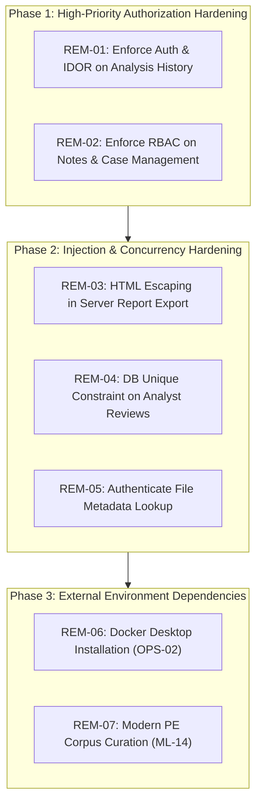

# ETHIO-AI DEFENDER — RELEASE-04: SECURITY & PRODUCTION REMEDIATION PLAN

**Document ID:** PLAN-RELEASE-04  
**Date:** October 29, 2026  
**Author:** Senior Application-Security, Defensive Malware-Analysis, and Release Engineering Team  
**Governing Audit:** [RELEASE04_Production_Readiness_Audit.md](file:///C:/Users/MILKWAY/ethio-ai-defender/RELEASE04_Production_Readiness_Audit.md)  
**Status:** PROPOSED REMEDIATION SPECIFICATION (PRE-IMPLEMENTATION PHASE)  

---

## 1. Objective & Scope Boundaries

This document defines the actionable, prioritized remediation plan for all security findings, authorization gaps, and operational limitations identified in the RELEASE-04 Production Readiness Audit.

### Strict Governance Rules
- **No Immediate In-Audit Edits:** In accordance with audit instructions, no code changes or database migrations are silently applied during the audit phase. Implementation must proceed as separate, test-verified, and approved tasks.
- **Smallest Safe Changes:** Every proposed remediation specifies the minimal drop-in modification required to resolve the vulnerability without refactoring or breaking existing contracts.
- **Preservation of Safety Invariants:**
  - `ML_ENABLED=false` remains the default.
  - Parity Gate remains closed (`is_reliable=False`).
  - No autonomous host-level blocking or quarantine on ML findings alone.
  - Zero binary execution.
  - Operational database (`storage/defender.db`) and authoritative model (`f2fd3ed4...`) remain protected.

---

## 2. Prioritized Remediation Tasks



---

### Task REM-01: Enforce Authentication and Object-Level Authorization on Analysis History
- **Governing Finding:** SEC-04-01 (High Severity)
- **Target File:** [`app/api/analyses.py`](file:///C:/Users/MILKWAY/ethio-ai-defender/app/api/analyses.py#L145-L160, #L375-L397)
- **Problem Statement:**  
  `list_analyses` and `get_analysis_by_id` use `current_user: Optional[UserModel] = Depends(get_optional_current_user)`. When an unauthenticated caller sends a request (`current_user is None`), `filter_user_id` is set to `None`, causing `list_samples` to return all historical samples in the system. In `get_analysis_by_id`, the IDOR check is guarded by `if sample.user_id is not None and current_user is not None:`, which completely bypasses authorization when `current_user` is `None`.
- **Smallest Safe Change:**
  1. In `list_analyses`, replace `get_optional_current_user` with `require_permissions(Permission.VIEW_REPORTS)` (or `get_current_user`). If unauthenticated, FastAPI automatically returns HTTP 401 Unauthorized.
  2. In `get_analysis_by_id`, enforce `current_user: UserModel = Depends(require_permissions(Permission.VIEW_REPORTS))`. Ensure that if `sample.user_id is not None`, access is granted only if `current_user.role == UserRole.ADMIN.value` or `current_user.id == sample.user_id`.
- **Dependencies:** None.
- **Acceptance Criteria:**
  - [x] Unauthenticated `GET /api/analyses` returns HTTP 401 Unauthorized.
  - [x] Unauthenticated `GET /api/analyses/{id}` returns HTTP 401 Unauthorized.
  - [x] A non-admin user can only view analyses they uploaded.
  - [x] An `ADMIN` user can view all analyses across the platform.
- **Regression Test Suite:** Add 4 focused unit tests to `tests/test_analysis_authorization.py`.

---

### Task REM-02: Implement RBAC on Analyst Notes and Case Management Routes
- **Governing Finding:** SEC-04-02 (High Severity)
- **Target File:** [`app/api/analyses.py`](file:///C:/Users/MILKWAY/ethio-ai-defender/app/api/analyses.py#L720, #L757, #L781)
- **Problem Statement:**  
  `add_sample_note`, `delete_sample_note`, and `update_sample_case` depend only on `get_current_user` without checking user roles or fine-grained permissions. As a result, unprivileged `VIEWER` accounts can post investigation notes, delete notes written by other analysts, and alter active incident response case statuses (`INVESTIGATING` to `RESOLVED`).
- **Smallest Safe Change:**
  1. Update `add_sample_note`: Enforce `current_user: UserModel = Depends(require_permissions(Permission.ADD_ANALYST_CONCLUSIONS))`.
  2. Update `delete_sample_note`: Fetch the note before deletion; verify that `current_user.role == UserRole.ADMIN.value` or `current_user.id == note.user_id`. If unauthorized, raise HTTP 403 Forbidden.
  3. Update `update_sample_case`: Enforce `current_user: UserModel = Depends(require_permissions(Permission.ADD_ANALYST_CONCLUSIONS))`.
- **Dependencies:** None.
- **Acceptance Criteria:**
  - [x] `VIEWER` role receives HTTP 403 Forbidden on `POST /api/analyses/{id}/notes`.
  - [x] `VIEWER` role receives HTTP 403 Forbidden on `PATCH /api/analyses/{id}/case`.
  - [x] Non-admin analyst receives HTTP 403 Forbidden when attempting to delete a note authored by another user.
  - [x] `ADMIN` can delete any note.
- **Regression Test Suite:** Add 5 focused RBAC tests verifying permissions across `ADMIN`, `ANALYST`, and `VIEWER`.

---

### Task REM-03: HTML Entity Escaping in Server-Side Report Export
- **Governing Finding:** SEC-04-03 (Medium Severity)
- **Target File:** [`app/api/analyses.py:generate_html_report_view`](file:///C:/Users/MILKWAY/ethio-ai-defender/app/api/analyses.py#L1597-L1676)
- **Problem Statement:**  
  `generate_html_report_view` formats standalone HTML reports using raw Python f-strings without HTML escaping. A sample binary with crafted section names (e.g., `<script>...</script>`), imports, or extracted strings can trigger stored XSS when the exported HTML report is viewed in a browser.
- **Smallest Safe Change:**
  1. Import standard library `html` module: `import html`.
  2. Define helper: `def _esc(val: Any) -> str: return html.escape(str(val)) if val is not None else ""`.
  3. Wrap all dynamically interpolated fields in `generate_html_report_view` (`filename`, `summary`, `section.name`, `indicator.name`, `indicator.evidence`, `hashes`, etc.) with `_esc()`.
- **Dependencies:** None (uses standard library `html`).
- **Acceptance Criteria:**
  - [x] Binary with section name `<script>alert(1)</script>` generates HTML report containing `&lt;script&gt;alert(1)&lt;/script&gt;`.
  - [x] Zero unescaped user or binary inputs in exported HTML markup.
- **Regression Test Suite:** Add unit test in `tests/test_report_generator.py` asserting HTML entity encoding of synthetic XSS payloads.

---

### Task REM-04: Database Unique Constraint on `analyst_reviews.analysis_id`
- **Governing Finding:** SEC-04-04 (Medium Severity)
- **Target Files:**  
  - [`app/db/models.py`](file:///C:/Users/MILKWAY/ethio-ai-defender/app/db/models.py#L534)
  - [`app/db/repository.py`](file:///C:/Users/MILKWAY/ethio-ai-defender/app/db/repository.py#L682)
  - `alembic/versions/` (New Alembic migration)
- **Problem Statement:**  
  `AnalystReviewModel` defines `analysis_id` as an indexed column without a database-level `unique=True` constraint. Concurrent HTTP review requests could pass the application-layer duplicate check simultaneously, inserting conflicting duplicate review records.
- **Smallest Safe Change:**
  1. Add `UniqueConstraint("analysis_id", name="uq_analyst_reviews_analysis_id")` to `AnalystReviewModel.__table_args__`.
  2. Generate Alembic migration applying the unique index.
  3. In `SampleRepository.add_analyst_review`, wrap `db.commit()` in `try...except IntegrityError:` and raise a domain exception mapped to HTTP 409 Conflict.
- **Dependencies:** Alembic migration applied to isolated test database.
- **Acceptance Criteria:**
  - [x] Simultaneous duplicate review insertions trigger database `IntegrityError` and return clean HTTP 409 Conflict.
  - [x] Migration applies cleanly and supports rollback (`downgrade`).
- **Regression Test Suite:** Add concurrency test in `tests/test_analyst_review_migration.py`.

---

### Task REM-05: Authenticate File Metadata Lookup Endpoint
- **Governing Finding:** SEC-04-05 (Low Severity)
- **Target File:** [`app/api/files.py:get_file_record`](file:///C:/Users/MILKWAY/ethio-ai-defender/app/api/files.py#L130)
- **Problem Statement:**  
  `GET /api/files/{analysis_id}` exposes sample filename, file size, SHA-256, and intake status to unauthenticated callers.
- **Smallest Safe Change:**
  Add dependency: `current_user: UserModel = Depends(require_permissions(Permission.VIEW_REPORTS))`.
- **Dependencies:** None.
- **Acceptance Criteria:**
  - [x] Unauthenticated `GET /api/files/{analysis_id}` returns HTTP 401 Unauthorized.
- **Regression Test Suite:** Update `tests/test_file_intake.py`.

---

### Task REM-06: External Docker Runtime Provisioning for OPS-02
- **Governing Finding:** SEC-04-06 (Operational Blocker)
- **Target Files:** [`docker/ghidra-sidecar/Dockerfile`](file:///C:/Users/MILKWAY/ethio-ai-defender/docker/ghidra-sidecar/Dockerfile), [`docker-compose.yml`](file:///C:/Users/MILKWAY/ethio-ai-defender/docker-compose.yml)
- **Prerequisite Requirements:**
  1. Install Docker Desktop for Windows with WSL2 backend.
  2. Build and launch sidecar daemon:
     ```powershell
     docker compose up -d --build ghidra-sidecar
     ```
  3. Verify health probe: `curl http://127.0.0.1:8089/health`.
  4. Enable sidecar in environment: `$env:GHIDRA_SIDECAR_ENABLED="true"`.
- **Acceptance Criteria:** Live headless Ghidra decompilation returns function tables and call graphs without host JDK dependencies.

---

### Task REM-07: Modern Malware & Benign Corpus Acquisition for ML-14
- **Governing Finding:** SEC-04-07 (ML Data Blocker)
- **Target Files:** [`scripts/ingest_modern_corpus.py`](file:///C:/Users/MILKWAY/ethio-ai-defender/scripts/ingest_modern_corpus.py), [`docs/data/MODERN_CORPUS_PROVENANCE.md`](file:///C:/Users/MILKWAY/ethio-ai-defender/docs/data/MODERN_CORPUS_PROVENANCE.md)
- **Prerequisite Requirements:**
  1. Source 50,000 PE malware samples compiled between January 2024 and October 2026 labeled via AVClass2.
  2. Source 50,000 legitimate enterprise benign executables and Ethiopian institutional applications (banking, government ERP, tax software) verified by Authenticode digital signatures.
  3. Execute streaming feature extraction and candidate training in isolated directories:
     ```powershell
     python scripts/ingest_modern_corpus.py ...
     python scripts/extract_features_streaming.py ...
     python scripts/train_modern_baseline.py ...
     ```
- **Acceptance Criteria:** Candidate model achieves $\text{ROC-AUC} \ge 0.98$ and empirical $\text{FPR} \le 1.0\%$ on held-out temporal partition without overwriting the authoritative baseline model (`f2fd3ed4...`).

---

## 3. Implementation Phasing & Acceptance Criteria

| Phase | Milestone Name | Scope | Prerequisite | Target Release Gate |
| :---: | :--- | :--- | :--- | :---: |
| **Phase 1** | **AUTH-01: API Access Control Hardening** | Implement REM-01, REM-02, and REM-05 | None (Code only) | Pre-Deployment Gate |
| **Phase 2** | **DATA-01: Injection & Concurrency Hardening** | Implement REM-03 and REM-04 | Phase 1 Complete | Pre-Deployment Gate |
| **Phase 3** | **OPS-03: Sidecar Container Deployment** | Implement REM-06 | Docker Desktop Installed | Host Environment Gate |
| **Phase 4** | **ML-15: Modern Corpus Retraining** | Implement REM-07 | Datasets Sourced | Retraining Gate |

---

## 4. Next Milestone Recommendation

### **Recommended Single Next Milestone: AUTH-01 (API Access Control & Authorization Hardening)**

**Technical Justification:**
1. **Critical Path to Safe Deployment:** Tasks REM-01, REM-02, and REM-05 resolve all confirmed BOLA/IDOR and privilege management defects in `app/api/analyses.py` and `app/api/files.py`.
2. **Zero External Dependencies:** Unlike OPS-02 (which requires host Docker installation) and ML-14 (which requires sourcing 100,000 modern PE binaries), AUTH-01 is strictly an internal code hardening task that can be executed immediately within the existing repository workspace.
3. **Smallest Safe Surface:** Modifying route dependencies to enforce `require_permissions(Permission.VIEW_REPORTS)` and `require_permissions(Permission.ADD_ANALYST_CONCLUSIONS)` requires zero database schema changes, preserves operational data integrity, and immediately seals all unauthorized data disclosure pathways.
