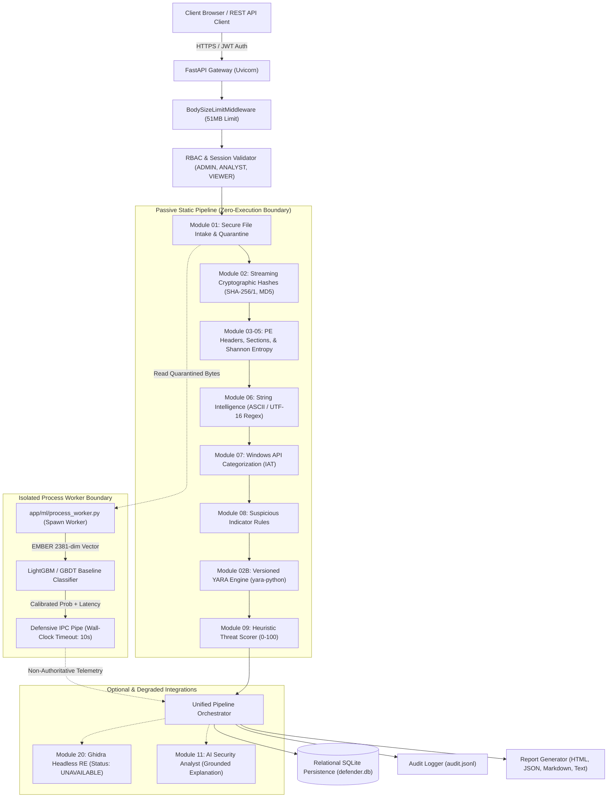
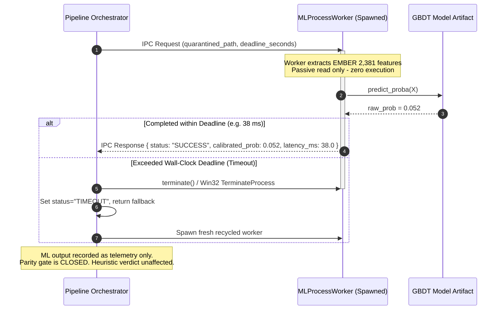

# ETHIO-AI DEFENDER — SYSTEM ARCHITECTURE & THREAT MODEL

**Classification:** Technical Documentation (DOC-01)  
**Platform Version:** 1.0.0 (Hardened Production Baseline)  
**Author:** Antigravity Engineering Pair

---

## 1. System Architecture Overview

ETHIO-AI Defender is structured as a defensive, multi-layer static malware analysis and reverse-engineering pipeline with strict physical and process-level isolation boundaries.

### 1.1 Architectural Flow

---

## 2. Process Isolation & Wall-Clock Timeout Sequence

To guarantee that untrusted, potentially malformed PE files or native C extensions cannot hang or compromise the main web server, ML feature extraction and inference operate in an isolated spawned worker process.

---

## 3. STRIDE Threat Model & Defensive Controls

| Threat Category | Threat Description | Platform Defensive Mitigation |
|---|---|---|
| **Spoofing** | Adversary attempts to forge user identity or spoof administrative requests. | PBKDF2-HMAC-SHA256 password hashing with independent per-user salt; signed HMAC-SHA256 JWT access tokens with unique JTI; instant session revocation on logout; `token_version` tracking invalidating stale tokens upon password reset or role alteration (`SEC-06`). |
| **Tampering** | Adversary attempts to tamper with stored rules, model artifacts, or quarantine files. | 1. **Model Artifacts:** Authoritative SHA-256 fingerprint verified against hardcoded `TRUSTED_BASELINE_MODEL_SHA256` prior to model instantiation. 2. **YARA Rules:** Immutable versioning schema with SHA-256 source hashing. `RESTRICT` foreign key integrity prevents deletion of referenced historical rules. 3. **Quarantine:** Stored in restricted permissions directory `storage/quarantine` with random UUID naming. |
| **Repudiation** | User denies uploading a file, publishing a rule, or exporting reports. | Append-only structured JSON security audit logger (`AuditLogger`) recording actor ID, IP address, timestamp, event type, and parameters. Audit events emitted for login, logout, file upload, rule publication, and report generation. |
| **Information Disclosure** | Sensitive server paths, tokens, or malicious sample payloads leaked to third parties. | 1. Internal absolute paths systematically scrubbed (`[REDACTED_PATH]/`). 2. Raw binary byte streams and executable payloads never forwarded to external AI providers or logs. 3. Redaction filters in audit logging scrub passwords, salts, tokens, and authorization headers. 4. Object-level authorization (IDOR protection) ensures analysts only access authorized samples. |
| **Denial of Service** | Oversized payloads, parser bombs, or hung inference worker exhaust server resources. | 1. `BodySizeLimitMiddleware` rejects oversized bodies (>51MB) prior to multipart parsing. 2. Native parsing and inference bounded by strict wall-clock timeout (`ML_TIMEOUT_SECONDS`, default 10s) with unconditional process termination (`TerminateProcess`). 3. Memory safety verified: LightGBM training sub-sampled to 80k rows, worker recycling after 500 tasks, peak RAM < 120 MiB. 4. Sliding window rate limiter for login and upload endpoints. |
| **Elevation of Privilege** | Attacker attempts to escalate from VIEWER to ANALYST or ADMIN. | 1. Strict three-tier RBAC (`ADMIN`, `ANALYST`, `VIEWER`). 2. `SELF_REGISTRATION_ROLES` defaults to `VIEWER`; `ADMIN` role can never be self-assigned. 3. All sensitive administration and publication routes enforce `has_permission()` checks in FastAPI dependencies. |

---

## 4. Fundamental Platform Invariants

1. **Zero Live Execution Guarantee:**
   Untrusted sample binaries are treated strictly as passive, immutable byte arrays for static structural inspection. Under no operational state or configuration are samples executed, mapped with write-and-execute permissions, or detonated.
2. **Closed Parity Gate & Non-Authoritative ML:**
   While the Parity Gate remains in state `OFFLINE_TEST_UNVERIFIED_PARITY`, machine learning scores are strictly experimental telemetry. ML models have **zero authority** over malicious verdicts, heuristic risk scores, alerts, or quarantine actions. Deterministic evidence and heuristic rules retain absolute authority.
3. **Graceful Fault Isolation:**
   Failure or timeout in any optional analysis stage (Ghidra, ML inference, cloud AI reasoning) degrades safely with structured status reporting (`UNAVAILABLE`, `TIMEOUT`, `FAILED`) without crashing or interrupting the primary static analysis pipeline.
