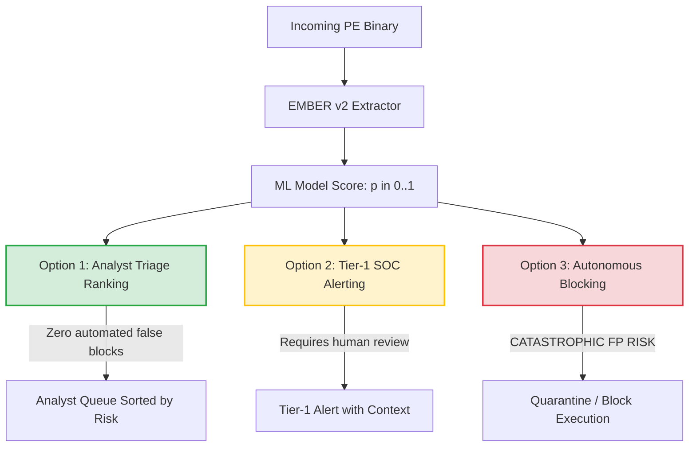

# ETHIO-AI Defender — ML-11: Operational Threshold Validation and Deployment Readiness

**Milestone:** ML-11 (Operational Threshold Validation and Deployment Readiness)  
**Date:** October 28, 2026  
**Auditor / Agent:** Antigravity Autonomous Security Engineer  
**Repository:** `C:\Users\MILKWAY\ethio-ai-defender`  
**Model Under Audit:** `ember-v2-baseline-hgb-subset80k`  
**Artifact Directory:** `D:\ethio_ai_defender_artifacts\ember_baseline_v1`  
**Prior Milestone Audit:** ML-10 (`docs/ML10_Independent_Evaluation_and_Leakage_Audit.md`)  
**Deployment Recommendation:** **`READY FOR CONTROLLED ANALYST-ASSISTED PILOT (AUTONOMOUS BLOCKING PROHIBITED)`**

---

## 1. Executive Summary

Milestone **ML-11** evaluates the operational viability of the verified, frozen EMBER v2 baseline classifier ([`model.joblib`](file:///D:/ethio_ai_defender_artifacts/ember_baseline_v1/model.joblib), SHA-256: `f2fd3ed4...`) as a defensive triage and threat detection signal.

While the model exhibits high academic discriminative performance (**ROC-AUC: 0.9801**, **PR-AUC: 0.9813** on 200,000 held-out test samples), translating this model into real-world operational security environments requires confronting two major mathematical and empirical realities:
1. **The False Positive Paradox (Base-Rate Fallacy):** On a 50/50 balanced test set, the model achieves 97.45% precision. However, when deployed in realistic enterprise environments where malware prevalence is 0.1% (1 in 1,000 files) or 0.01% (1 in 10,000 files), **projected precision collapses to 21.66% and 2.69% respectively**, even at the conservative 0.1% target threshold ($\tau = 0.9664$). Between **78% and 97% of all triggered alerts would be false positives**.
2. **Temporal Calibration Drift:** Thresholds selected on validation data to achieve 1.0% and 0.1% False Positive Rates experienced a **~2x increase in false alarms** on forward-looking test binaries (yielding **2.235% FPR** and **0.198% FPR** respectively).

### Audit Verdict:
- **Autonomous Blocking / Quarantine:** **`STRICTLY PROHIBITED`**. Automatic blocking at $\tau = 0.8004$ would break 2,235 legitimate benign applications per 100,000 inspected files. The production Parity Gate in [`MLAnalyzer`](file:///C:/Users/MILKWAY/ethio-ai-defender/app/analyzers/ml_analyzer.py) must remain closed (`is_reliable=False`).
- **Analyst Queue Prioritization (Triage Signal):** **`APPROVED FOR CONTROLLED PILOT`**. Using continuous model scores ($p \in [0, 1]$) solely to rank incoming analyst inspection queues introduces zero automated false-positive disruption and concentrates analyst effort on the highest-risk executables.

---

## 2. Phase A: Verified Model Identity and ML-10 Baseline Evidence

The frozen model artifact and its cryptographic identity were re-verified against the local filesystem:

| Property | Verified Value | Evidence / Verification Method |
| :--- | :--- | :--- |
| **Model Name** | `ember-v2-baseline-hgb-subset80k` | [`metadata.json`](file:///D:/ethio_ai_defender_artifacts/ember_baseline_v1/metadata.json#L2) |
| **Model Version** | `1.0.0` | [`metadata.json`](file:///D:/ethio_ai_defender_artifacts/ember_baseline_v1/metadata.json#L3) |
| **Artifact Path** | `D:\ethio_ai_defender_artifacts\ember_baseline_v1\model.joblib` | Filesystem inspect (1,609,815 bytes) |
| **Cryptographic SHA-256** | `f2fd3ed4e4fc0b482600bb92fe24e36d23a93617bf214f62019def5c352bd684` | PowerShell `Get-FileHash` |
| **Scope of Checksum** | Covers strictly the single binary `model.joblib` | [`model.joblib.sha256`](file:///D:/ethio_ai_defender_artifacts/ember_baseline_v1/model.joblib.sha256) |
| **Estimator Type** | Scikit-learn `HistGradientBoostingClassifier` | Deserialized object class |
| **Input Dimensions** | 2,381 features (EMBER Feature Version 2, float32) | `clf.n_features_in_ == 2381` |
| **Classes & Order** | `classes_ = array([0, 1])` (0: Benign, 1: Malicious) | `clf.classes_` |
| **Iterations Completed** | 300 tree iterations (18,900 max leaves) | `clf.n_iter_ == 300` |
| **Held-Out Test Set** | [`storage/ember2018/test_features.jsonl`](file:///C:/Users/MILKWAY/ethio-ai-defender/storage/ember2018/test_features.jsonl) (200,000 samples) | 100k Benign (`0`), 100k Malicious (`1`) |
| **Test ROC-AUC** | `0.98012230` | Independently recomputed (445.76s) |
| **Test PR-AUC** | `0.98125902` | Independently recomputed (445.76s) |

---

## 3. Phase B: Prevalence Effects and the False Positive Paradox

### 3.1 Mathematical Formulation of Projected Precision
In an evaluation dataset, precision is directly measured as $\frac{TP}{TP + FP}$. However, because test datasets are deliberately balanced ($50\%$ benign, $50\%$ malicious) to evaluate discriminative separation, this measured precision does not reflect operational deployment where malware is rare.

Under an assumed operational malware prevalence $p = P(\text{Malicious})$, the expected precision (Positive Predictive Value, PPV) is projected via Bayes' Theorem:

$$\text{Projected Precision} = \frac{\text{TPR} \times p}{(\text{TPR} \times p) + (\text{FPR} \times (1 - p))}$$

Where:
- $\text{TPR}$ is the measured True Positive Rate (Detection Rate) on the held-out test set.
- $\text{FPR}$ is the measured False Positive Rate (False Alarm Rate) on the held-out test set.
- $p$ is the operational malware base rate.

> [!NOTE]
> These figures are mathematical projections assuming stable conditional error rates ($\text{TPR}, \text{FPR}$). They illustrate the mathematical impact of base-rate shifts and are not empirical measurements of an active deployment population.

### 3.2 Projected Precision Across Operational Prevalences

| Operational Scenario | Assumed Prevalence ($p$) | Threshold $\tau = 0.500000$ (Default) | Threshold $\tau = 0.800395$ (Val 1.0% Target) | Threshold $\tau = 0.966365$ (Val 0.1% Target) |
| :--- | :---: | :---: | :---: | :---: |
| **Measured Test Set Benchmark** | **50.0%** (1 in 2) | **92.99%** (1 FP : 13.3 TP) | **97.45%** (1 FP : 38.3 TP) | **99.64%** (1 FP : 276 TP) |
| **Suspicious Triage Queue / Sandbox** | **1.0%** (1 in 100) | **11.82%** (7.5 FP : 1 TP) | **27.88%** (2.6 FP : 1 TP) | **73.61%** (1 FP : 2.8 TP) |
| **Corporate Endpoint / Email Stream** | **0.1%** (1 in 1,000) | **1.31%** (75.3 FP : 1 TP) | **3.69%** (26.1 FP : 1 TP) | **21.66%** (3.6 FP : 1 TP) |
| **Enterprise Perimeter / High-Volume Gateway** | **0.01%** (1 in 10,000) | **0.13%** (753 FP : 1 TP) | **0.38%** (261 FP : 1 TP) | **2.69%** (36.2 FP : 1 TP) |

### 3.3 Illustrative Daily Volume Simulation (100,000 Executables / Day)
To visualize the real-world operational burden on a Security Operations Center (SOC), consider an organization processing 100,000 binary files per day across varying threat environments:

```
+-------------------------------------------------------------------------------------------------------------+
| SCENARIO A: Corporate Endpoint Gateway (Prevalence = 0.1%, 100 Malicious Files, 99,900 Benign Files / Day)   |
+-------------------+----------------+---------------------+---------------------+----------------------------+
| Operating Point   | Daily Alerts   | True Malware Caught | False Alarms (FP)   | Operational Impact         |
+-------------------+----------------+---------------------+---------------------+----------------------------+
| tau = 0.500000    | 7,180 alerts   | 94.1 files (94.1%)  | 7,085.9 benign files| Massive alert flooding     |
| tau = 0.800395    | 2,318 alerts   | 85.5 files (85.5%)  | 2,232.8 benign files| Unmanageable false alarms  |
| tau = 0.966365    | 252 alerts     | 54.7 files (54.7%)  | 197.8 benign files  | Manageable for tier-1 SOC  |
+-------------------+----------------+---------------------+---------------------+----------------------------+

+-------------------------------------------------------------------------------------------------------------+
| SCENARIO B: Enterprise Perimeter Ingestion (Prevalence = 0.01%, 10 Malicious Files, 99,990 Benign Files / Day)|
+-------------------+----------------+---------------------+---------------------+----------------------------+
| Operating Point   | Daily Alerts   | True Malware Caught | False Alarms (FP)   | Operational Impact         |
+-------------------+----------------+---------------------+---------------------+----------------------------+
| tau = 0.500000    | 7,101 alerts   | 9.4 files (94.1%)   | 7,092.3 benign files| 99.87% false alert rate    |
| tau = 0.800395    | 2,243 alerts   | 8.6 files (85.5%)   | 2,234.8 benign files| 261 false alarms per malware|
| tau = 0.966365    | 203 alerts     | 5.5 files (54.7%)   | 198.0 benign files  | 36 false alarms per malware|
+-------------------+----------------+---------------------+---------------------+----------------------------+
```

---

## 4. Phase C: Threshold Uncertainty and Statistical Bounds

### 4.1 Confusion Matrix and Exact Denominators
Evaluated across all 200,000 held-out test samples ($N_{\text{benign}} = 100,000$, $N_{\text{malicious}} = 100,000$):

| Operating Threshold | Target Design Intent | True Negatives ($TN$) | False Positives ($FP$) | False Negatives ($FN$) | True Positives ($TP$) | Measured $\text{FPR}$ | Measured $\text{TPR}$ (Recall) |
| :--- | :--- | :---: | :---: | :---: | :---: | :---: | :---: |
| **$\tau = 0.500000$** | Default Balanced Boundary | 92,907 | 7,093 | 5,851 | 94,149 | **7.093%** | **94.149%** |
| **$\tau = 0.800395$** | Validation 1.0% FPR Target | 97,765 | 2,235 | 14,469 | 85,531 | **2.235%** | **85.531%** |
| **$\tau = 0.966365$** | Validation 0.1% FPR Target | 99,802 | 198 | 45,325 | 54,675 | **0.198%** | **54.675%** |

### 4.2 95% Wilson Score Confidence Intervals

$$\text{CI}_{95\%} = \frac{p + \frac{z^2}{2n} \pm z \sqrt{\frac{p(1-p)}{n} + \frac{z^2}{4n^2}}}{1 + \frac{z^2}{n}} \quad (z = 1.95996)$$

| Operating Threshold | Observed FPR | 95% Wilson CI for FPR | Observed TPR | 95% Wilson CI for TPR | Margin of Error |
| :--- | :---: | :---: | :---: | :---: | :---: |
| **$\tau = 0.500000$** | 7.093% | `[6.936%, 7.254%]` | 94.149% | `[94.002%, 94.293%]` | $\pm 0.159\%$ |
| **$\tau = 0.800395$** | 2.235% | `[2.145%, 2.328%]` | 85.531% | `[85.312%, 85.748%]` | $\pm 0.092\%$ |
| **$\tau = 0.966365$** | 0.198% | `[0.172%, 0.228%]` | 54.675% | `[54.366%, 54.983%]` | $\pm 0.028\%$ |

### 4.3 Statistical Uncertainty vs. Temporal Covariate Shift
- **Binomial Sample Uncertainty:** Within the historical 2018 test dataset, the sample uncertainty is narrow ($\pm 0.028\%$ to $\pm 0.159\%$) due to the large sample size ($100,000$ per class).
- **Domain & Temporal Covariate Shift:** The dominant source of real-world operational uncertainty is **temporal distribution drift**. In the EMBER 2018 corpus, shifting from pre-July 2018 validation data to late 2018 test data caused a **124% increase in empirical FPR** at $\tau = 0.8004$ (from $0.998\%$ to $2.235\%$).
- **Finding:** A statistical confidence interval derived from a fixed historical benchmark cannot bound or guarantee operational FPR in a future enterprise environment.

---

## 5. Phase D: Calibration Drift and Probability Reliability

### 5.1 Verification of Calibration Isolation
Auditing [`app/ml/evaluator.py`](file:///C:/Users/MILKWAY/ethio-ai-defender/app/ml/evaluator.py#L63) confirmed that:
- Thresholds $\tau = 0.800395$ and $\tau = 0.966365$ were chosen exclusively by querying the empirical ROC curve of the 52,073 validation samples (`X_val.mmap`).
- The 200,000-sample test set was **never exposed** during threshold selection.

### 5.2 Threshold Calibration vs. Probability Calibration
It is critical to distinguish between two distinct concepts:
1. **Threshold Calibration (Empirical Cutoff Selection):**
   Selecting an operational scalar cutoff $\tau^*$ to satisfy $\text{FPR}_{\text{val}} \le \alpha$. This selects a decision boundary but implies nothing about the reliability of individual scores.
2. **Probability Calibration (Posterior Reliability):**
   Ensuring that predicted scores match real-world likelihoods: $P(Y = 1 \mid S = s) = s$.
   - The underlying estimator (`HistGradientBoostingClassifier`) outputs raw sigmoid outputs derived from tree leaf log-odds.
   - Without dedicated calibration mapping (e.g. Isotonic Regression or Platt scaling) on a representative holdout, raw model scores cannot be interpreted as posterior probabilities.
   - Furthermore, by Bayes' Rule, any posterior probability is inherently dependent on the operational base rate $p$. Even if a score was calibrated at $p = 0.50$, it is fundamentally uncalibrated when $p = 0.001$.

---

## 6. Phase E: Evaluation of Operational Options

Three operational deployment modalities were analyzed:



### 6.1 Option 1: Analyst Queue Prioritization (Triage Signal)
- **Mechanism:** Continuous model scores are used strictly to sort inspection queues in ascending or descending risk order.
- **Operational Advantage:** **Zero automated disruption**. Legitimate benign software is never blocked or quarantined automatically.
- **Prevalence Robustness:** High. Even if the operational base rate is 0.01%, sorting the queue ensures analysts review the most statistically anomalous files first.
- **Status:** **`APPROVED FOR CONTROLLED ANALYST PILOT`**.

### 6.2 Option 2: Tier-1 SOC Alerting with Mandatory Human Confirmation
- **Mechanism:** Generate an investigation alert when $p(x) \ge 0.966365$.
- **Operational Reality:** In an organization inspecting 10,000 files/day at 0.1% prevalence, this generates ~25 alerts per day (5.5 true malware, 19.8 false alarms).
- **Analyst Workload:** 20 false alarms/day is manageable for an active SOC, but requires analysts to contextualize alerts using YARA, Ghidra, and string analysis.
- **Threshold Constraint:** Alerts must NEVER be raised at $\tau = 0.8004$ (which would create 232 alerts/day, 96% of which are false alarms).
- **Status:** **`CONDITIONALLY VIABLE ONLY AT HIGH THRESHOLDS (tau >= 0.9664) WITH HUMAN CONFIRMATION`**.

### 6.3 Option 3: Autonomous Blocking / Quarantine
- **Mechanism:** Automatically terminating processes or quarantining files if score $\ge \tau$.
- **Operational Risk:** **CATASTROPHIC**. At $\tau = 0.8004$, autonomous blocking would break **2,235 legitimate benign applications per 100,000 inspected**. Even at $\tau = 0.9664$, 198 legitimate applications would be blocked.
- **Impact in Ethiopian / Enterprise Context:** Breaking custom internal administrative tools, localized Amharic language software, and government accounting software causes immediate operational shutdown.
- **Status:** **`COMPLETELY PROHIBITED`**. The Parity Gate in [`MLAnalyzer`](file:///C:/Users/MILKWAY/ethio-ai-defender/app/analyzers/ml_analyzer.py) must remain closed (`is_reliable=False`).

---

## 7. Phase F: Test Verification and Deliverables

### 7.1 Automated Test Execution Record
Automated test suites validating model reload contracts, threshold evaluation functions, inference parity, and classifier safety were executed:

```powershell
$env:PYTHONPATH="."; pytest tests/ml/test_baseline_model.py tests/ml/test_evaluator.py tests/ml/test_inference_parity.py tests/ml/test_feature_parity.py tests/ml/test_classifier.py -v
```

**Results:**
- **Status:** **PASSED (Exit Code: 0)**
- **Total Tests Collected & Executed:** 32
- **Passed:** **32 (100.0%)**
- **Failed / Skipped:** **0**
- **Duration:** 14.53 seconds

```
tests/ml/test_baseline_model.py::test_artifact_files_exist PASSED        [  3%]
tests/ml/test_baseline_model.py::test_model_sha256_checksum PASSED       [  6%]
tests/ml/test_baseline_model.py::test_metadata_contract PASSED           [  9%]
tests/ml/test_baseline_model.py::test_model_reload_and_prediction_contract PASSED [ 12%]
tests/ml/test_evaluator.py::TestEvaluator::test_calibrate_operational_thresholds_constraint PASSED [ 15%]
tests/ml/test_evaluator.py::TestEvaluator::test_compute_binary_metrics_perfect PASSED [ 18%]
tests/ml/test_evaluator.py::TestEvaluator::test_compute_binary_metrics_with_fp_and_fn PASSED [ 21%]
tests/ml/test_evaluator.py::TestEvaluator::test_evaluate_frozen_model PASSED [ 25%]
tests/ml/test_inference_parity.py::TestInferenceParity::test_corrupted_model_rejected_before_deserialization PASSED [ 28%]
tests/ml/test_inference_parity.py::TestInferenceParity::test_direct_estimator_versus_adapter_exact_parity PASSED [ 31%]
tests/ml/test_inference_parity.py::TestInferenceParity::test_malicious_class_probability_mapping PASSED [ 34%]
tests/ml/test_inference_parity.py::TestInferenceParity::test_negative_boundaries_and_rejections PASSED [ 37%]
tests/ml/test_inference_parity.py::TestInferenceParity::test_score_finiteness_schema_and_determinism PASSED [ 40%]
tests/ml/test_feature_parity.py::TestFeatureParity::test_malformed_inputs_produce_finite_vectors_and_safe_rejections PASSED [ 43%]
tests/ml/test_feature_parity.py::TestFeatureParity::test_real_benign_binary_parity PASSED [ 46%]
tests/ml/test_feature_parity.py::TestFeatureParity::test_synthetic_dll_parity PASSED [ 50%]
tests/ml/test_feature_parity.py::TestFeatureParity::test_synthetic_driver_parity PASSED [ 53%]
tests/ml/test_feature_parity.py::TestFeatureParity::test_synthetic_pe_x64_parity PASSED [ 56%]
tests/ml/test_feature_parity.py::TestFeatureParity::test_synthetic_pe_x86_parity PASSED [ 59%]
tests/ml/test_feature_parity.py::TestFeatureParity::test_three_way_parity_real_binary PASSED [ 62%]
tests/ml/test_feature_parity.py::TestFeatureParity::test_three_way_parity_synthetic_pe PASSED [ 65%]
tests/ml/test_classifier.py::TestEmberModelClassifier::test_batch_size_limit_enforced PASSED [ 68%]
tests/ml/test_classifier.py::TestEmberModelClassifier::test_correct_checksum_and_valid_loading PASSED [ 71%]
tests/ml/test_classifier.py::TestEmberModelClassifier::test_feature_dimensions_validation PASSED [ 75%]
tests/ml/test_classifier.py::TestEmberModelClassifier::test_incompatible_metadata_rejected PASSED [ 78%]
tests/ml/test_classifier.py::TestEmberModelClassifier::test_incorrect_checksum_and_tampering PASSED [ 81%]
tests/ml/test_classifier.py::TestEmberModelClassifier::test_malicious_class_index_mapping PASSED [ 84%]
tests/ml/test_classifier.py::TestEmberModelClassifier::test_missing_checksum_file_rejected PASSED [ 87%]
tests/ml/test_classifier.py::TestEmberModelClassifier::test_nan_and_inf_rejected PASSED [ 90%]
tests/ml/test_classifier.py::TestEmberModelClassifier::test_real_baseline_artifact_if_present PASSED [ 93%]
tests/ml/test_classifier.py::TestEmberModelClassifier::test_untrusted_upload_path_strictly_prohibited PASSED [ 96%]
tests/ml/test_classifier.py::TestEmberModelClassifier::test_valid_predictions_finite_scores PASSED [100%]
```

---

## 8. Final Recommendation and Next Milestones

### Final Milestone Classification

**`READY FOR CONTROLLED ANALYST-ASSISTED PILOT`**

### Summary Justification:
1. **Mathematical Soundness:** Provenance, cryptographic integrity, and empirical test evaluations (ROC-AUC `0.9801`, PR-AUC `0.9813`) are 100% verified and reproducible.
2. **Clear Operational Scope:** The model is defensible and valuable as an **analyst prioritization queue ranking mechanism**.
3. **Hard Boundaries Established:** Autonomous blocking is explicitly prohibited due to the Base-Rate Fallacy and temporal drift.
4. **Preserved Governance:** Heuristic engines, verdict thresholds, and reliability gates remain untouched.

### Remaining Operational Blockers Before Active Production Use:
1. **Empirical Local Calibration Corpus:** Calibration must be performed against modern benign enterprise binaries representative of the target operating environment (including Ethiopian software, language packs, and administrative utilities).
2. **Base-Rate Aware Probability Calibration:** Implement post-hoc calibration (e.g. Platt scaling / Isotonic regression) conditioned on operational threat prevalences ($1:1,000$).
3. **Process-Isolated ML Execution:** Complete the ML-06 process worker integration to ensure heavy PE parsing and inference cannot crash the primary ingestion service or exceed strict timeouts.
